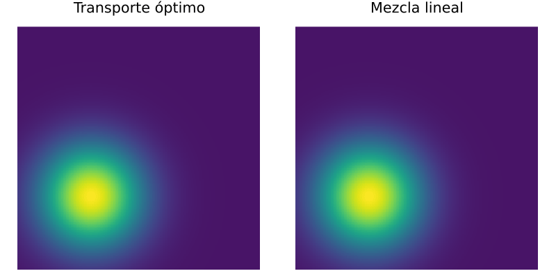
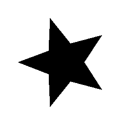
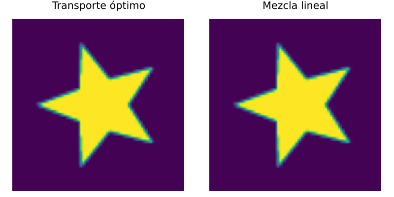
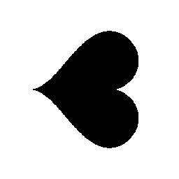
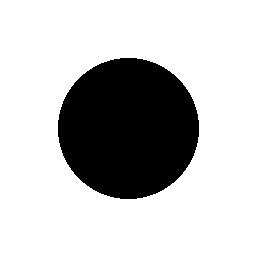
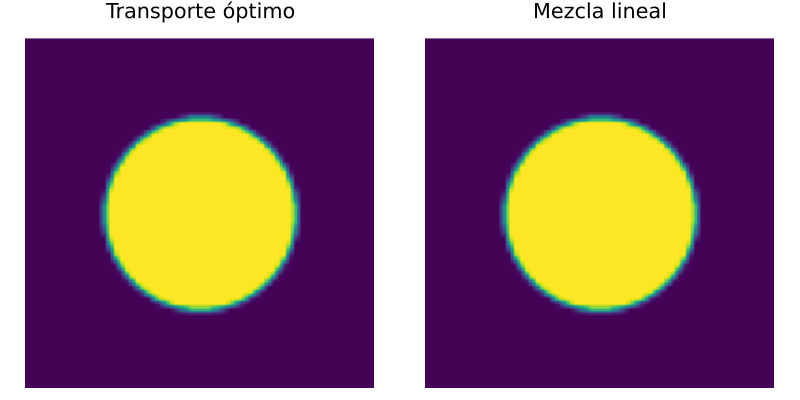
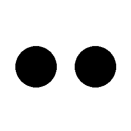
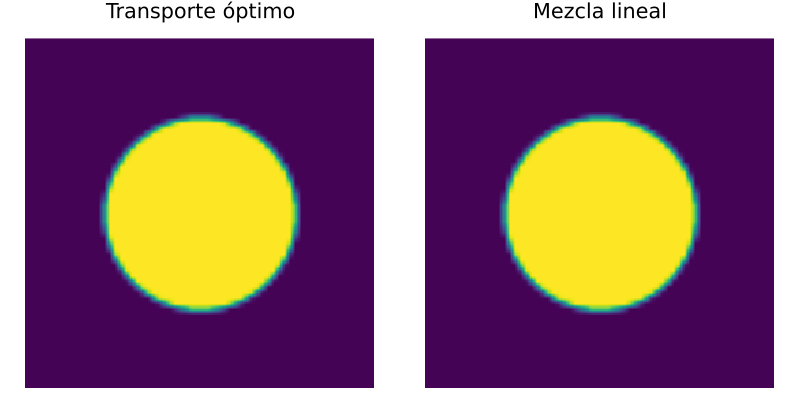
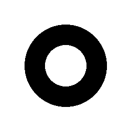
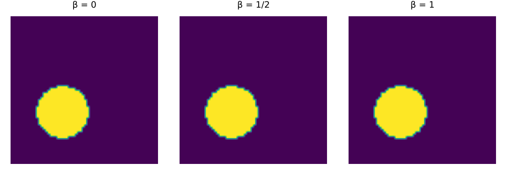

<!-- TODO: reemplazar por el GIF principal del proyecto -->
{fig-align="center" width="70%"}

## Resumen

<!-- TODO: 2–3 frases. Ejemplo: -->
Dadas dos imágenes, buscamos la forma "más económica" de transformar una en otra.
Interpretamos cada imagen como una distribución de masa y calculamos la
trayectoria de transporte óptimo entre ambas, formulada como un problema de
control óptimo: la densidad es el estado y el campo de velocidades es el control.

## El problema

Sean $\rho_0$ y $\rho_1$ dos densidades (las imágenes normalizadas) en un dominio
$\Omega \subset \mathbb{R}^2$. La formulación dinámica de Benamou–Brenier busca

$$
\min_{\rho,\, v} \; \int_0^1 \!\! \int_\Omega \frac{1}{2}\, \rho(t,x)\, |v(t,x)|^2 \, dx\, dt
$$

sujeto a la ecuación de continuidad y las condiciones de borde

$$
\partial_t \rho + \nabla \cdot (\rho v) = 0, \qquad \rho(0,\cdot) = \rho_0, \qquad \rho(1,\cdot) = \rho_1 .
$$

El valor óptimo coincide con $\tfrac12 W_2^2(\rho_0,\rho_1)$, la distancia de
Wasserstein, y la trayectoria $\rho(t,\cdot)$ es la interpolación (el *morphing*).

## Convexificación

Con el cambio de variables $m = \rho v$ (momento), el problema queda

$$
\min_{\rho,\, m} \; \int_0^1 \!\! \int_\Omega \frac{|m|^2}{2\rho}\, dx\, dt
\quad \text{s.a.} \quad \partial_t \rho + \nabla \cdot m = 0 ,
$$

que es **convexo**: el integrando $(\rho, m) \mapsto |m|^2 / 2\rho$ es convexo y la
restricción es lineal.

## Método numérico

Seguimos el esquema de *proximal splitting* de Papadakis, Peyré y Oudet (2014).

**Discretización.** Usamos una grilla espacio-tiempo de $N \times P$ puntos en $(x,y)$ y $Q$ en $t$.
Las variables viven en una **grilla escalonada** $U$: cada componente de $(m_x, m_y, \rho)$ está
en las caras perpendiculares a su eje, lo que permite escribir la divergencia
$\partial_t \rho + \nabla\cdot m$ de forma exacta y simple. La energía se evalúa en una
**grilla centrada** $V = \mathcal{I}(U)$, que se obtiene promediando caras vecinas.

**Problema discreto.** Con la condición de consenso $V = \mathcal{I}(U)$, el problema queda como
una suma de tres funciones convexas:

$$
\min_{U,\,V}\; J(V) \;+\; \iota_{\{\operatorname{div} U = 0\}}(U) \;+\; \iota_{\{V = \mathcal{I}(U),\ \rho(0)=\rho_0,\ \rho(1)=\rho_1\}}(U,V),
$$

donde $J(V) = \sum |m|^2 / 2\rho$ e $\iota$ es la indicatriz del conjunto (0 dentro, $+\infty$ fuera).

**Algoritmo.** Usamos Douglas–Rachford de promedio paralelo (PPXA): en cada iteración se aplica el
operador proximal de cada término por separado y se promedian los resultados. Los tres pasos tienen
solución explícita:

1. **Prox de la energía**, punto a punto: $\rho^\star$ es la raíz positiva de la cúbica
   $(\rho-\tilde\rho)(\rho+\gamma)^2 - \tfrac{\gamma}{2}|\tilde m|^2 = 0$, que se resuelve por Newton,
   y luego $m^\star = \frac{\rho^\star}{\rho^\star+\gamma}\,\tilde m$.
2. **Proyección sobre la continuidad**: se resuelve una ecuación de Poisson 3D con condiciones de
   Neumann mediante la transformada coseno (DCT), y se corrige $U \leftarrow U - \nabla p$ solo en
   las caras interiores. Así se preservan los datos $\rho_0, \rho_1$ y la condición de no-flujo en el borde.
3. **Proyección de consenso** $V = \mathcal{I}(U)$: es una proyección afín pequeña, que se resuelve
   línea por línea a lo largo de cada eje con una pseudoinversa precalculada. La implementación
   procesa todas las líneas de un eje en un solo producto matricial.

**Parámetros.** $\gamma = 1/230$, $\mu = 1.98$ y pesos $\omega = (\tfrac13, \tfrac13, \tfrac13)$.
Partimos de la mezcla lineal $(1-t)\rho_0 + t\rho_1$ y hacemos entre 500 y 1000 iteraciones,
monitoreando $\|\operatorname{div} U\|_\infty$.

**Costos generalizados.** Cambiando $\rho$ por $\rho^\beta$ en la energía, solo cambia el polinomio
del paso 1. Con $\beta = 1$ se recupera el transporte óptimo y con $\beta = 0$ la mezcla lineal.

**Implementación.** Todo está programado desde cero en Julia (con FFTW para la DCT). Cada pieza
tiene un test propio: adjunto de $\mathcal{I}$, raíz de la cúbica, solver de Poisson (orden 2),
$\operatorname{div} = 0$ tras la proyección, y equivalencia entre la versión vectorizada de la
proyección de consenso y la original.

## Resultados

<!-- TODO: un bloque por ejemplo. Imagen inicial → GIF → imagen final -->

::: {layout-ncol=1}
{fig-align="center" width="50%"}
:::

::: {layout-ncol=3}
{fig-align="center" width="50%"}

{fig-align="center" width="50%"}
:::

::: {layout-ncol=3}
{fig-align="center" width="50%"}

{fig-align="center" width="50%"}
:::

::: {layout-ncol=3}
{fig-align="center" width="50%"}

{fig-align="center" width="50%"}
:::

::: {layout-ncol=1}
{fig-align="center" width="25%"}
:::

::: {layout-ncol=1}
{fig-align="center" width="100%"}
:::

::: {layout-ncol=1}
{fig-align="center" width="50%"}
:::

## Código

El código completo está en la pestaña [Código](proyecto.ipynb) y en el
[repositorio de GitHub](https://github.com/morphing-ma4703/morphing). <!-- TODO -->

## Referencias

- J.-D. Benamou y Y. Brenier (2000). *A computational fluid mechanics solution to the Monge–Kantorovich mass transfer problem.* Numerische Mathematik, 84(3), 375–393.
- N. Papadakis, G. Peyré y E. Oudet (2014). *Optimal transport with proximal splitting.* SIAM Journal on Imaging Sciences, 7(1), 212–238.
